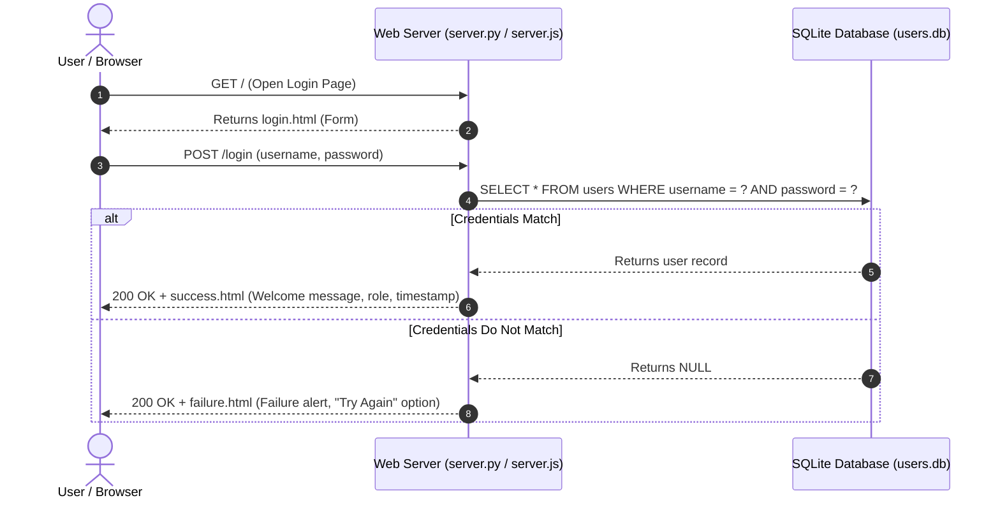

# User Validation Web Application (Lab 11)

A full-stack user authentication and validation web application. The client submits a login name and password to the server; the server queries an SQLite database to verify credentials, returning a **Successful Login Page** if the credentials match or a **Failure Message Page** if they do not.

---

## 📋 Problem Statement
> **User Validation Web Application**: The user submits their login name and password to the server. The name and password are checked against the data already available in the Database. If the data matches, a successful login page is returned. Otherwise, a failure message is shown to the user.

---

## 🛠️ Tech Stack & Features
- **Frontend**: Clean, modern, responsive HTML5 & CSS3 with card layouts, alert badges, and status screens.
- **Backend**:
  - **Python 3**: Native `http.server` + built-in `sqlite3` (Zero external dependencies).
  - **Node.js**: Native `http` + built-in `node:sqlite` (Zero external dependencies).
- **Database**: Embedded **SQLite 3** (`users.db`), auto-initialized and seeded on first launch.
- **Security**: Parameterized SQL queries preventing SQL injection attacks.

---

## 📂 Project Structure

```text
validerted lab 11/
├── server.py              # Python backend server (port 8000)
├── server.js              # Node.js backend server (port 3000)
├── database.py            # SQLite database manager (Python)
├── database.js            # SQLite database manager (Node.js)
├── users.db               # SQLite database file (auto-generated & pre-seeded)
├── test_unit.py           # Automated unit test suite (Python)
├── test_unit.js           # Automated unit test suite (Node.js)
├── public/
│   └── css/
│       └── style.css      # Professional responsive CSS styling
├── templates/
│   ├── login.html         # Login form page with credential helper
│   ├── success.html       # Successful login page (returns on valid credentials)
│   ├── failure.html       # Failure message page (returns on invalid credentials)
│   ├── register.html      # User registration form
│   └── users.html         # View database users table
└── README.md              # Project documentation & lab guide
```

---

## 🔑 Pre-seeded Test Database Credentials

When the database is created, the following default accounts are pre-populated:

| Username / Login Name | Password | Full Name | Role |
| :--- | :--- | :--- | :--- |
| `admin` | `admin123` | System Administrator | Administrator |
| `john_doe` | `password123` | John Doe | Student |
| `alice` | `securePass2024` | Alice Smith | Instructor |

You can also use the **Register New User** page (`/register`) to add your own user credentials dynamically.

---

## 🚀 How to Run the Application

You can run the application with **either** Python or Node.js. Both use the same SQLite database and templates.

### Option 1: Run with Python 3 (Default Port: `8000`)
```bash
python3 server.py
```
Open your browser and navigate to:
```
http://localhost:8000
```

### Option 2: Run with Node.js (Default Port: `3000`)
```bash
node server.js
```
Open your browser and navigate to:
```
http://localhost:3000
```

---

## 🔄 Application Workflow



---

## 🧪 Automated Testing & Verification

Run the Python verification test suite:
```bash
python3 test_unit.py
```

Run the Node.js verification test suite:
```bash
node test_unit.js
```

Both test suites verify:
1. `GET /` serves the login form.
2. `POST /login` with valid credentials returns the **Successful Login Page**.
3. `POST /login` with invalid password returns the **Failure Message Page**.
4. `POST /login` with non-existent user returns the **Failure Message Page**.
5. Dynamic registration adds a record to `users.db`.
6. Successful login with the newly created credentials.
7. Inspection of all database records via `/users`.

---

## 💡 Key Web Development Concepts for Viva / Review

1. **Why use POST instead of GET for login?**
   - In `GET`, parameters are appended to the URL query string (`?username=...&password=...`), which gets logged in browser history, server access logs, and referrer headers.
   - `POST` transmits credentials inside the request body, keeping them out of URL logs and caching proxies.

2. **How is SQL Injection prevented?**
   - The application uses **parameterized queries** (`?` placeholders):
     ```python
     cursor.execute("SELECT * FROM users WHERE username = ? AND password = ?", (username, password))
     ```
   - User inputs are strictly treated as data literals rather than executable SQL commands.

3. **Database Schema**:
   ```sql
   CREATE TABLE users (
       id INTEGER PRIMARY KEY AUTOINCREMENT,
       username TEXT UNIQUE NOT NULL,
       password TEXT NOT NULL,
       full_name TEXT NOT NULL,
       role TEXT DEFAULT 'Student',
       created_at TIMESTAMP DEFAULT CURRENT_TIMESTAMP
   );
   ```
